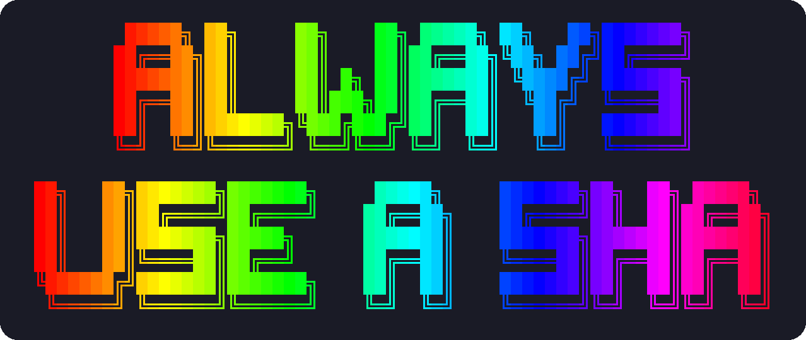

# terminal-fun

I recently found out that ghostty supports Kitty Graphics now.  So these are fun, interesting experiments to make the terminal fresh again.

This may grow to a bunch of random crap. Some useful.  Some not.  Most not, probably.

This will be pretty much all AI generated, so, take that for what you will. I'm mostly just playing around here.  Also, I'm sorry for the long AI output. I'll try to find time to edit it in my own voice.

IMPORTANT:  You can run these from your terminal directly from GitHub, but for the love of god, ALWAYS pin to a sha.  I can't give you the exact commands in the examples, since, you know, it changes when I commit it. But, you can figure that out for yourself.

(you can see [ascii_art](https://github.com/misterek/ascii_art) for some fun, non kitty terminal stuff)

Enjoy!

| | |
|---|---|
| [background](background/) | A slow animated plasma, marbled swirls that hold still, or a picture of your choice, behind the text in your terminal. It runs as an ordinary background job, needs no terminal config, and works over SSH. |
| [graph](graph/) | A live line graph over a corner of your terminal: a Grafana or Prometheus query, any command that prints a number, or numbers on a pipe. Or a live table, like a `kubectl get pods` that lights up what changed. An agent like Claude Code can pop one up from its own shell. |
| [picture](picture/) | A picture in a corner of your terminal: a file, which it watches for changes, or a URL, fetched again as often as you like. Animated GIFs play. An agent like Claude Code can pop one up to show you a chart it made. |

MIT licensed; see [LICENSE](LICENSE).
